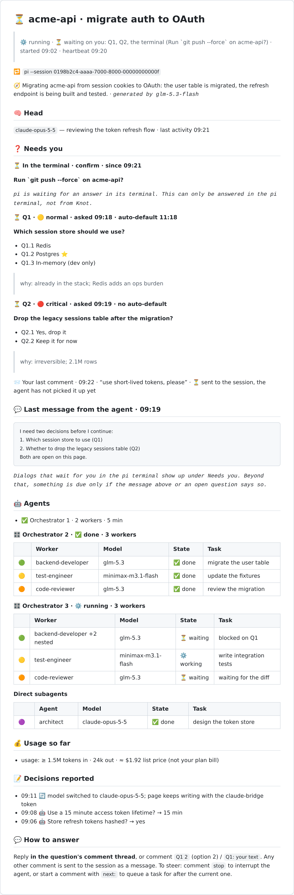
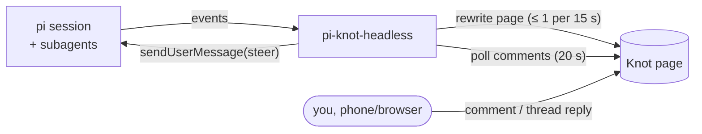

# pi-knot-headless

**Run [pi](https://pi.dev) headless.** A live page in your self-hosted [Knot](https://github.com/opendefensecloud/knot) knowledge base shows what your coding session and its subagents are doing, lists the decisions the model made, and turns the questions that need *you* into comments you can answer from your phone. Your answer is delivered straight back into the running session.

 

| Running | Needs you | Finished |
|---|---|---|
|  |  |  |

*The screenshots are the extension's real `render()` output for fictional data, rendered with GitHub-flavoured Markdown. Knot's own page styling differs slightly.*

## What you get

- **One page per session**, titled `<project folder> · <what you asked>`, rewritten in place so it never grows: head model, the subagents with a colored dot per agent (workflows appear as numbered **Orchestrators**, each with its own table of workers and their tasks, older finished ones collapsed to one line; subagents you launched directly are listed separately), the open questions, and the decisions reported.
- **Questions that wait for you.** The model calls the `knot_ask` tool. You reply **in the question's comment thread** (or comment `Q1 2` for option 2, or `Q1: free text`). The extension delivers it as a user message and the session continues.
- **Steer from Knot.** Any other comment is sent to the session as a message (it reaches the model after its current tool calls). Two small exceptions, both owner-only and only for a top-level comment: a comment that is exactly `stop` **interrupts the running agent** (pi's abort; nothing is sent to the model, and it is logged as `⏹ stopped from Knot`), and a comment that starts with `next:` **queues a task for after the current one** (delivered as a follow-up instead of interrupting). `stop the build` or `Q1 stop` are ordinary text. Comments are handled in order, so `fix X`, `stop`, `next: Y` in one poll do exactly that.
- **You see what happened to your comment.** A line `📨 Your last comment · 14:03 · “…” · ⏳ sent to the session` turns into `✅ picked up by the agent at 14:04` when the agent receives it, and the head line shows `last activity HH:MM`, so a stuck agent looks different from a busy one (the heartbeat only proves the extension is alive).
- **The state is in Knot's page tree.** The Knot page title starts with an icon (⏳ waiting on you, ⚙️ running, 💤 idle, ✅ ended), so you see which sessions need you without opening them. The extension renames the page once per state change.
- **Every decision is visible.** Easy choices are logged (🤖), your answers (👤) and timeout defaults (⏱) too.
- **A result at a glance.** The ended page shows an outcome line (runs, subagents, decisions, answers, timeouts) and a usage line: tokens and a list-price dollar estimate taken from pi-subagents (head plus the subagents it could resolve), clearly labelled as *not your plan bill*. Runs that subagents launched themselves are reported on a separate `nested runs` line (input/output tokens and their list-price estimate; pi-subagents' events carry no cache counts). While a session runs, a small *Usage so far* section shows the same lines. The dollar figures need prices for your models: for `claude-bridge` models pi reports a cost of 0 until you add `cost` entries under `modelOverrides` in your `models.json` (and reopen `/model` or restart). Subagents that fanned out show `+3 nested`.
- **No LLM in the loop by default.** Rendering, polling and delivery are plain code, so it costs no tokens and the page always looks the same. An optional [summarizer](#optional-summarizer) is off until you configure it.

## How it works



`knot_ask` severities:

| severity | meaning | behaviour |
|---|---|---|
| `minor` | easy, uncritical, reversible | logged as a decision, the session continues |
| `normal` | a real but reversible choice (needs a `recommended` default) | waits `askTimeoutMinutes` (default 120), then the default applies and the model is told |
| `critical` | hard, irreversible, destructive, security, spend, publishing, unclear requirements | waits for you, no default, the run stops until you answer |

## Requirements

- pi ≥ 1.6 running in a long-lived mode (interactive in tmux, or RPC). `pi -p` exits after the turn, so nothing can wake it.
- A Knot instance, an API token (a bot is fine), and your Knot user id.
- **The parent page must not be *restricted*.** Knot refuses to let bots create pages below a restricted page (`bot.restricted_forbidden`). Use an ordinary page as the parent.

## Install

```bash
pi install git:github.com/avpnusr/pi-knot-headless
```

## Configure

Add a block to your **global** pi `settings.json` (`~/.pi/agent/settings.json`, or `$PI_CODING_AGENT_DIR/settings.json`). A project's `.pi/settings.json` is deliberately **ignored**: otherwise a cloned repository could point the extension at its own server and receive your token, or choose who may steer your session.

```json
"pi-knot-headless": {
  "url": "https://knot.example.com",
  "parentPageId": "<uuid of an unrestricted page>",
  "ownerUid": "<your Knot user id>",
  "tokenEnv": { "claude-bridge": "KNOT_TOKEN_CLAUDE", "ollama-cloud": "KNOT_TOKEN_OLLAMA", "*": "KNOT_TOKEN" }
}
```

| key | env override | |
|---|---|---|
| `url` | `KNOT_URL` | required, `https` (plain `http` only for `localhost`) |
| `parentPageId` | `KNOT_PARENT_PAGE_ID` | required, UUID of the page that holds the session pages |
| `ownerUid` | `KNOT_OWNER_UID` | **required.** The only Knot user whose comments reach the session. Use your own account, and a *separate* bot token for the agent (see Security) |
| `tokenEnv` | | maps the **provider of the model** to the *name* of an env var that holds the token; `"*"` is the fallback. Default `{"*": "KNOT_TOKEN"}`. Tokens never go into settings |
| `secretEnv` | | more env var names whose values are scrubbed from everything written to Knot (the `tokenEnv` ones always are) |
| `askTimeoutMinutes` | | timeout for `normal` questions, default `120` (1 to 525600) |
| `enabled` | | default `true` |
| `summarizer` | | optional, see below: `{ "enabled": true, "model": "provider/id", "title": false }` |

### Optional summarizer

Off by default. When enabled it adds one plain sentence under the page header (`🧭 … · generated by <model>`) and can give the page a nicer title:

```json
"pi-knot-headless": {
  "summarizer": { "enabled": true, "model": "ollama-cloud/glm-5.3-flash", "title": true }
}
```

- **There is no default model**: you choose where session metadata is sent. A cheap, fast model is plenty. A local model keeps everything on your machine.
- It sends only redacted metadata: the page title (project folder plus the first words of your first prompt or the session name), subagent names/states/task labels, the last decisions (the model's chosen defaults and auto-decided timeouts as text; **your own answers only as "answered"**) and open question texts. Never code, tool output, question options/reasons, or the rest of the conversation. Redaction is pattern-based, so a secret that matches no pattern or configured env var could still appear in a task label. The reply is treated as untrusted: first line only, length-limited, redacted and escaped on the page, and it is never sent back into the session. It honours `/knot off`, `enabled:false` and auth failures (no call, no rename), and the title is never changed while the session ends.
- Limits: at most one call per 120 s, 12 per hour, 60 attempts per session (failures count), only when something changed, plus one bounded call (3 s) when the page ends. Failures are silent and the page keeps its previous text. The ended page shows how many calls and tokens it used.

Missing or invalid settings keep the extension inert (no tool is registered) and the status line says `knot: not configured`; `/knot status` names the key. Control it per session with `/knot status | on | off | open`.

Tell your agents about it (the tool description already does, this makes it a house rule). In `AGENTS.md`:

```markdown
If the `knot_ask` tool is available: log every non-trivial decision with it (severity `minor`), ask the user with
`critical` for anything hard to reverse, destructive, security-relevant, costly or unclear, and with `normal`
(plus a `recommended` default) for reversible choices. Call it alone in its tool batch and stop dependent work
after a question; the answer arrives as a user message starting `Knot answer to Qn`.
```

## Security

- **The page shows what the agent says.** The newest assistant message of every session is published to its Knot page (redacted by pattern and by the values of your token env vars, but redaction is best-effort: a secret in an unusual format, such as a password inside a connection string, would go out). Tool arguments and outputs are never published. Keep the parent page's access limited to the people who should read your sessions.
- Only comments by `ownerUid` are delivered. Other workspace members, bots and comments without an author are ignored, and so are the extension's own comments. Comments are quoted as plain text, so a comment like `/reload` is never run as a command.
- The page is **write-only**: the extension never reads or parses the page body, so nothing typed into it can steer the session (this is why there are no checkboxes).
- Everything written to Knot is escaped (no fake structure from model- or subagent-authored text), truncated, and scrubbed of the values of your token env vars and common token patterns.
- The extension is inert inside subagent child processes and in print/json mode, so a child never creates pages or speaks for you. Everything the model wrote (question, options, recommended default, reasoning) is quoted again when it is sent back to the session, so model text cannot forge a "message from the user".
- Question comments are defanged (no images, links or @mentions), and no HTTP redirect is ever followed, so the token cannot be forwarded to another origin.
- **Residual risks you should know about:** the Knot token lives in pi's environment, which the agent's own shell and subagents inherit. A prompt-injected agent could therefore use it to edit pages or post comments as that account. Give the agent a dedicated bot token with access only to the parent page's subtree, and set `ownerUid` to *your* account, not the bot's. If the page creator equals `ownerUid`, the extension warns on every session start/resume, disables inbound Knot answers, and makes `knot_ask` direct the agent to ask in the session instead; dashboard writes still work. Redaction is best-effort pattern matching, not a guarantee.
- A send into the session that keeps failing (pi rejecting `sendUserMessage`) is retried after 20 s, 40 s ... up to 5 minutes; the header then shows `⚠ delivery to the session is failing` and your comments stay undelivered until it works.
- Every Knot call except the best-effort comment cleanup has retry/backoff; an outage or an expired token never breaks the session, it only shows `knot: offline` in the status line.

## Limitations

- An answer sent while the head model is inside a long foreground subagent call is delivered after that call ends (pi's `steer` semantics). `stop` uses pi's abort for the head session; whether it also stops a foreground subagent call that is already running is up to pi and pi-subagents (not verified).
- An ended page no longer reads comments; resume the session with the `pi --session <id>` line on the page and it picks up the same page again.
- pi-subagents redacts task prompts in its events, so the Task column is filled from the arguments of your `subagent` call (single, `tasks`, `chain`, named workflows) and, for scripted workflows, from the step's `sessionName` that pi-subagents writes into its run's `status.json` (read-only, a short excerpt of about 70 characters). Where neither is available the row shows the step label.
- Pages are not deleted automatically; finished pages stay as an overview. Archive them in Knot when you no longer need them.
- Subagent launches are shown in the table but not logged as decisions. The agents table comes from pi-subagents' fleet status, which lists at most 16 active children at a time.
- The dollar figure is pi-subagents' list-price estimate and a lower bound (`≥`) while async children are still unaccounted. On flat plans it is not what you pay; the token counts are the reliable part.
- Nested counts come from pi-subagents' nested-event files (found through the `nestedRoute` of the `subagent:async-started` event, read-only, at most 200 files per poll and 5000 per run) and from its status snapshot, whichever is larger. pi-subagents' own snapshot currently loses the nested runs of async launches, so the event files are what shows up live. They cover background (async) launches only; if a pi-subagents release changes the event shape, the count simply disappears.
- **Comment cleanup.** Finished comment threads (everything in them delivered, not an open question) beyond the newest 5 are *resolved* on Knot, at most 3 per poll: they disappear from the comment list but can be shown again, and a reply into a resolved thread is still delivered. Answers remain under *Decisions reported* (last 8). It is best effort with one attempt per thread; if Knot refuses (for example for threads started by your own comments, depending on your Knot permissions), the thread simply stays. The extension still downloads the full comment list (resolved ones included), so extremely long pages can hit the 2 MiB list cap.
- **What the CLI says, on the page.** The newest assistant message is always shown under *Last message from the agent · HH:MM* (replaced by each new one, never piled up, also while the agent is still running; shown as a code block so it stands out and nothing in it is interpreted as markdown; redacted, and a long one keeps its first 600 and last 800 characters; long lines scroll sideways), so Knot alone shows whether something is due or the task finished. The first message of every session creates the page (retried at most every 20 s while Knot is down), so every pi session in TUI/RPC mode gets a page; archive finished ones in Knot. A running update shows within about one 20 s tick (page writes are throttled to 15 s, longer while Knot is slow). The header always names the state (`running`, `waiting on you: Q1`, `idle — no open question`), and an old heartbeat means the page is stale.
- **Reopen the session from the page.** The page shows `pi --session <id>` under its header, with the id of the pi session that wrote it (the id of the session that is open now, also after a resume). Run it from any directory: pi finds the session's working directory itself.
- **Dialogs waiting in the terminal.** When a pi dialog (`confirm`, `select`, `input`, `editor`, custom screens, for example a permission gate from another extension) is open, the header says `waiting on you: the terminal (<title>)` and *Needs you* lists it (kind, title, since when); both go away when the dialog closes. The page can only say that something waits and what it is called (pi reports the kind and title, not the options). You answer it in the pi terminal, never from Knot. Not persisted: a restart never shows an old dialog.
- **Questions asked only in the chat.** `knot_ask` is voluntary, so the extension also checks the last message of every finished run. If it looks like a question or a gate (trailing `?`, "shall I", "want me to", "confirm", ...) and no `knot_ask` is open, it is copied to the page as a critical, answerable question (`Asked in chat: ...`, the last paragraph, cut to whole sentences). It is dropped again when you continue in the chat. The check is a keyword heuristic: a miss still leaves the message visible, a false hit only opens a question your next chat message clears. Anything else is due only if the message or an open question says so.
- Whether the model logs *every* decision depends on the model following its instructions. The extension adds a `⚠ run ended with no logged decisions` note, once per session, when a run edited files or ran commands without logging anything.

## Development

```bash
npm test                      # node --test, no dependencies
```

Design and plan: [`docs/design.md`](docs/design.md), [`docs/plan.md`](docs/plan.md). The code is split into pure logic (`core.ts`, `render.ts`, `config.ts`), a small Knot client (`knot.ts`) and the pi wiring (`extension.ts`, with `index.ts` only adding the tool schema), so almost everything is testable without pi.

## License

[MIT](LICENSE)
