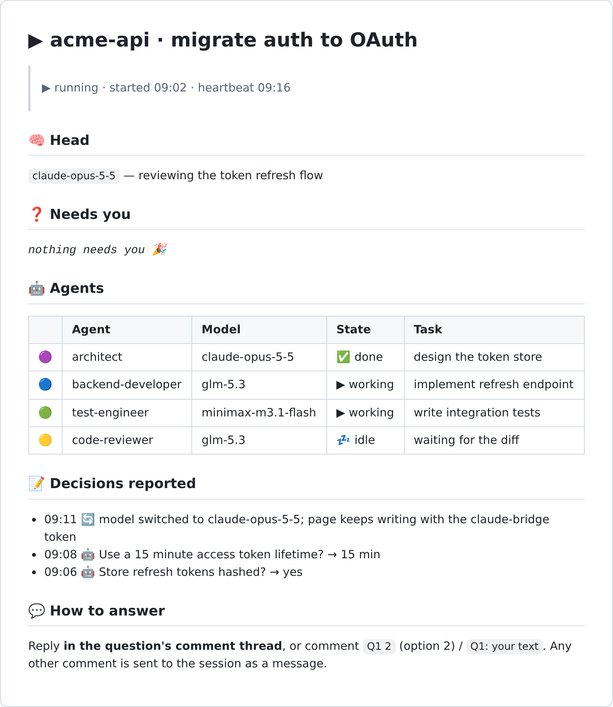
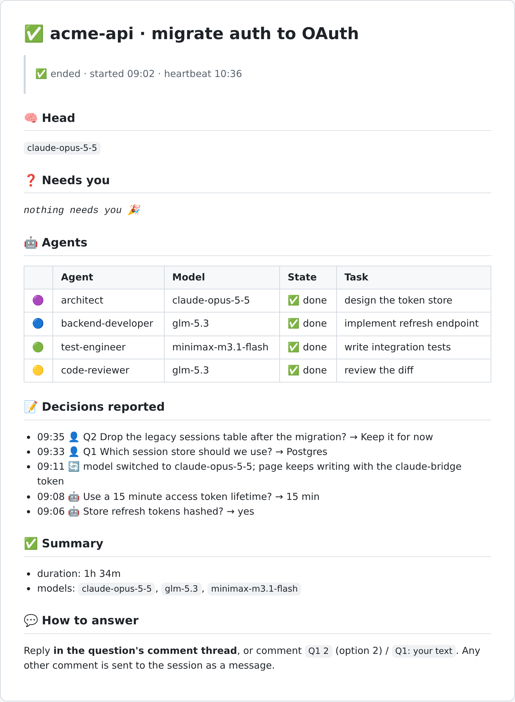

# pi-knot-headless

**Run [pi](https://pi.dev) headless.** A live page in your self-hosted [Knot](https://github.com/opendefensecloud/knot) knowledge base shows what your coding session and its subagents are doing, lists the decisions the model made, and turns the questions that need *you* into comments you can answer from your phone. Your answer is delivered straight back into the running session.

  

| Running | Needs you | Finished |
|---|---|---|
|  |  |  |

*The screenshots are the extension's real `render()` output for fictional data, rendered with GitHub-flavoured Markdown. Knot's own page styling differs slightly.*

## What you get

- **One page per session**, titled `<project folder> · <what you asked>`, rewritten in place so it never grows: head model, a table of subagents with a colored dot per agent, their model, state and task, the open questions, and the decisions reported.
- **Questions that wait for you.** The model calls the `knot_ask` tool. You reply **in the question's comment thread** (or comment `Q1 2` for option 2, or `Q1: free text`). The extension delivers it as a user message and the session continues.
- **Every decision is visible.** Easy choices are logged (🤖), your answers (👤) and timeout defaults (⏱) too.
- **No LLM in the loop.** Rendering, polling and delivery are plain code, so it costs no tokens and the page always looks the same.

## How it works


`knot_ask` severities:

| severity | meaning | behaviour |
|---|---|---|
| `minor` | easy, uncritical, reversible | logged as a decision, the session continues |
| `normal` | a real but reversible choice (needs a `recommended` default) | waits `askTimeoutMinutes` (default 120), then the default applies and the model is told |
| `critical` | hard, irreversible, destructive, security, spend, publishing, unclear requirements | waits for you, no default, the run stops until you answer |

## Requirements

- pi ≥ 1.6 running in a long-lived mode (interactive in tmux, or RPC). `pi -p` exits after the turn, so nothing can wake it.
- A Knot instance, an API token (a bot is fine), and your Knot user id.
- **The parent page must not be *restricted*.** Knot refuses to let bots create pages below a restricted page (`bot.restricted_forbidden`). Use an ordinary page as the parent.

## Install

```bash
pi install git:github.com/avpnusr/pi-knot-headless
```

## Configure

Add a block to pi's `settings.json` (`~/.pi/agent/settings.json`; a project's `.pi/settings.json` overrides it):

```json
"pi-knot-headless": {
  "url": "https://knot.example.com",
  "parentPageId": "<uuid of an unrestricted page>",
  "ownerUid": "<your Knot user id>",
  "tokenEnv": { "claude-bridge": "KNOT_TOKEN_CLAUDE", "ollama-cloud": "KNOT_TOKEN_OLLAMA", "*": "KNOT_TOKEN" },
  "secretEnv": ["GITHUB_TOKEN"]
}
```

| key | env override | |
|---|---|---|
| `url` | `KNOT_URL` | required, `https` (plain `http` only for `localhost`) |
| `parentPageId` | `KNOT_PARENT_PAGE_ID` | required, UUID of the page that holds the session pages |
| `ownerUid` | `KNOT_OWNER_UID` | the only user whose comments reach the session. If omitted: the creator of the parent page (refused if that is the agent's own account) |
| `tokenEnv` | | maps the **provider of the model** to the *name* of an env var that holds the token; `"*"` is the fallback. Default `{"*": "KNOT_TOKEN"}`. Tokens never go into settings |
| `secretEnv` | | more env var names whose values are scrubbed from everything written to Knot (the `tokenEnv` ones always are) |
| `askTimeoutMinutes` | | timeout for `normal` questions, default `120` |
| `enabled` | | default `true` |

Missing or invalid settings keep the extension inert and tell you which key is wrong. Control it per session with `/knot status | on | off | open`.

Tell your agents about it (the tool description already does, this makes it a house rule). In `AGENTS.md`:

```markdown
If the `knot_ask` tool is available: log every non-trivial decision with it (severity `minor`), ask the user with
`critical` for anything hard to reverse, destructive, security-relevant, costly or unclear, and with `normal`
(plus a `recommended` default) for reversible choices. Call it alone in its tool batch and stop dependent work
after a question; the answer arrives as a user message starting `Knot answer to Qn`.
```

## Security

- Only comments by `ownerUid` are delivered. Other workspace members, bots and comments without an author are ignored, and so are the extension's own comments. Comments are quoted as plain text, so a comment like `/reload` is never run as a command.
- The page is **write-only**: the extension never reads or parses the page body, so nothing typed into it can steer the session (this is why there are no checkboxes).
- Everything written to Knot is escaped (no fake structure from model- or subagent-authored text), truncated, and scrubbed of the values of your token env vars and common token patterns.
- The extension is inert inside subagent child processes and in print/json mode, so a child never creates pages or speaks for you.
- Every Knot call has retry/backoff; an outage or an expired token never breaks the session, it only shows `knot: offline` in the status line.

## Limitations

- An answer sent while the head model is inside a long foreground subagent call is delivered after that call ends (pi's `steer` semantics).
- The Task column of background subagents is often empty: pi-subagents redacts the task prompt in its events.
- Pages are not deleted automatically; finished pages stay as an overview. Archive them in Knot when you no longer need them.
- Whether the model logs *every* decision depends on the model following its instructions. The extension adds a `⚠ run ended with no logged decisions` note when a run edited files or ran commands without logging anything.

## Development

```bash
npm test                      # 70 tests, node --test, no dependencies
scripts/scan.sh               # secret / personal-data scan; install as .git/hooks/pre-push
scripts/preview.sh out/ && node scripts/shoot.mjs out/   # regenerate the README screenshots
```

Design and plan: [`docs/design.md`](docs/design.md), [`docs/plan.md`](docs/plan.md). The code is split into pure logic (`core.ts`, `render.ts`, `config.ts`), a small Knot client (`knot.ts`) and the pi wiring (`extension.ts`, with `index.ts` only adding the tool schema), so almost everything is testable without pi.

## License

[MIT](LICENSE)
